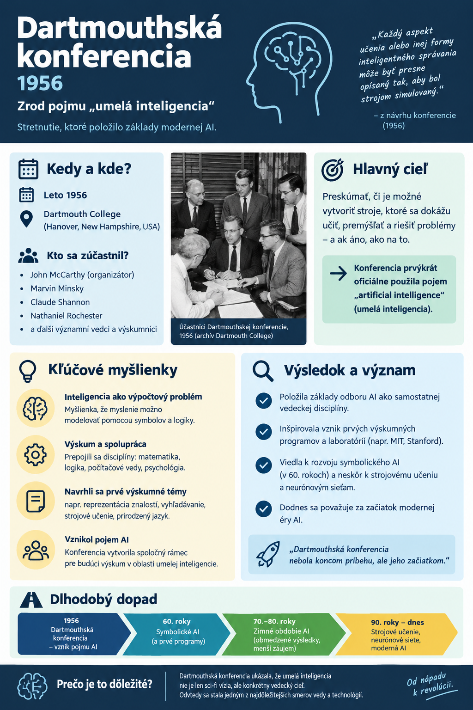

# História umelej inteligencie  

Umelá inteligencia (AI) je odbor informatiky, ktorý skúma metódy, ktoré  
umožňujú počítačom vykonávať úlohy spájané s ľudskou inteligenciou. Patria  
medzi ne vnímanie, učenie, plánovanie, porozumenie jazyku a rozhodovanie.  
AI nie je jeden algoritmus, ale široká skupina prístupov – od pravidiel  
a logiky až po neurónové siete trénované na dátach.  

Vývoj AI neprebiehal priamočiaro. Obdobia veľkého optimizmu striedali fázy,  
keď technológia nedokázala splniť sľuby a financovanie výskumu kleslo.  
Dnešný pokrok stojí najmä na kombinácii kvalitných dát, výkonného hardvéru,  
pokročilých algoritmov a rozsiahleho inžinierskeho zázemia.  

## Obsah  

- [Rané základy](#rané-základy)  
- [Dartmouthská konferencia](#dartmouthská-konferencia-1956)  
- [Symbolická AI a prvé systémy](#symbolická-ai-a-prvé-systémy)  
- [AI zimy](#ai-zimy)  
- [Návrat strojového učenia](#návrat-strojového-učenia)  
- [Hlboké učenie a moderná AI](#hlboké-učenie-a-moderná-ai)  
- [Veľké jazykové modely](#veľké-jazykové-modely)  
- [AI a vízie sci-fi](#ai-a-vízie-sci-fi)  
- [Výzvy a príležitosti](#výzvy-a-príležitosti)  
- [Otázky na diskusiu](#otázky-na-diskusiu)  
- [Odporúčané zdroje](#odporúčané-zdroje)  

## Rané základy  

Korene AI siahajú k formálnej logike, teórii pravdepodobnosti a teórii  
výpočtu.  

### Ada Lovelace a Analytický stroj  

Už v 19. storočí navrhol Charles Babbage Analytický stroj – mechanický  
počítač s pamäťou, aritmetickou jednotkou a programom na diernych štítkoch.  
Stroj nebol nikdy dokončený. Ada Lovelace, ktorá s Babbageom  
spolupracovala, k nemu v roku 1843 napísala rozsiahle poznámky. Uviedla  
v nich postup na výpočet Bernoulliho čísel, ktorý sa často označuje  
za prvý počítačový program.  

Jej pohľad na stroj spájal dve myšlienky, ktoré sú aktuálne dodnes:  
uznanie jeho obrovského potenciálu a zásadnú filozofickú výhradu.  

**Predvídanie symbolického spracovania.** Lovelace si uvedomila, že stroj  
nemusí pracovať výlučne s číslami. Čísla a symboly môžu reprezentovať  
akékoľvek informácie, napríklad hudbu alebo logické vzťahy:  

> „Ak by sa napríklad základné vzťahy tónov vo vede o harmónii a hudobnej  
> kompozícii dali vyjadriť a prispôsobiť takémuto spracovaniu, stroj by  
> mohol skladať prepracované a vedecky podložené hudobné skladby  
> akejkoľvek zložitosti či rozsahu.“  

Myšlienka, že počítač môže spracúvať rôzne druhy dát a symbolov, je  
základom dnešného softvéru aj multimodálnych modelov AI, ktoré pracujú  
s textom, obrazom, zvukom či kódom.  

**Námietka lady Lovelaceovej.** Zároveň však napísala výrok, ktorý sa  
dodnes používa ako argument proti tvrdeniu, že stroje skutočne myslia  
alebo sú samostatne tvorivé:  

> „Analytický stroj si vôbec nenárokuje niečo *vytvárať*. Dokáže urobiť  
> čokoľvek, čo mu vieme prikázať vykonať. Dokáže sledovať analýzu, no  
> nemá schopnosť predvídať akékoľvek analytické vzťahy či pravdy.“  

Lovelace teda vnímala stroj ako pokročilý nástroj na realizáciu ľudských  
myšlienok, nie ako samostatnú bytosť s vlastnými zámermi. Jej výhrada je  
predchodcom dnešnej debaty o tom, či veľké jazykové modely svet skutočne  
chápu, alebo len štatisticky spájajú slová podľa tréningových dát. Kritici  
pre ne v roku 2021 použili označenie *stochastické papagáje*.  

Ada Lovelace tak predvídala univerzálnosť výpočtovej techniky a zároveň  
pomenovala hranicu, o ktorej sa vedci a filozofi sporia dodnes: rozdiel  
medzi presvedčivou simuláciou inteligencie a skutočným porozumením.  

### Turing a otázka strojového myslenia  

Alan Turing v práci *On Computable Numbers* (1936) opísal  
abstraktný model výpočtu, dnes známy ako Turingov stroj. Nešlo o hotový  
počítač, ale o teoretický základ pre uvažovanie o tom, čo možno algoritmicky  
vypočítať.  

V článku *Computing Machinery and Intelligence* (1950) Turing položil otázku  
„Môžu stroje myslieť?“ a navrhol takzvanú imitačnú hru (*imitation game*),  
neskôr známu ako Turingov test. Test meria podobnosť správania  
v konverzácii; sám osebe však nie je dôkazom vedomia, porozumenia ani  
všeobecnej inteligencie. V tom istom článku Turing rozobral aj  
„námietku lady Lovelaceovej“. Odpovedal, že stroje nás môžu prekvapiť  
a že aj učiaci sa stroj môže dospieť k výsledkom, ktoré jeho autor  
nepredvídal.  

### Prvé neurónové modely  

Už v 40. rokoch vznikali aj prvé umelé neurónové modely. Práca Warrena  
McCullocha a Waltera Pittsa (1943) ukázala, ako možno jednoduché logické  
operácie modelovať pomocou idealizovaných neurónov. Na tieto myšlienky  
nadviazal Frank Rosenblatt, ktorý v roku 1958 predstavil perceptrón –  
jeden z prvých učiacich sa neurónových modelov.  

## Dartmouthská konferencia (1956)  

Za symbolický začiatok AI ako samostatnej vedeckej disciplíny sa často  
považuje letný workshop na Dartmouth College v Hanoveri (New Hampshire,  
USA) v roku 1956. Organizátormi boli John McCarthy, Marvin Minsky,  
Nathaniel Rochester a Claude Shannon. V návrhu projektu z roku 1955 použili  
pomenovanie *artificial intelligence*, ktoré sa následne rozšírilo.  

  

Návrh vychádzal z odvážnej hypotézy, že aspekty učenia a inteligencie možno  
opísať dostatočne presne na to, aby ich stroj dokázal simulovať. Táto  
hypotéza otvorila priestor pre výskum logického uvažovania, riešenia úloh,  
jazyka, vnímania aj učenia. Neznamenala však, že všeobecná inteligencia  
bude vytvorená v krátkom čase.  

Medzi dôležité osobnosti raného obdobia patrili aj Allen Newell a Herbert  
Simon, autori programu Logic Theorist. Program dokázal dokazovať vybrané  
matematické vety pomocou symbolického vyhľadávania. John McCarthy neskôr  
navrhol jazyk LISP (1958), ktorý sa stal významným nástrojom výskumu AI.  

> **Pre študentov:** AI od začiatku nebola iba programovaním pravidiel.  
> Spájala matematiku, logiku, psychológiu, lingvistiku, filozofiu  
> a inžinierstvo.  

## Symbolická AI a prvé systémy  

Rané systémy vychádzali z predstavy, že inteligentné správanie možno  
vytvoriť manipuláciou so symbolmi podľa explicitných pravidiel. Tento smer  
sa neskôr označoval aj ako symbolická AI alebo GOFAI  
(*Good Old-Fashioned AI*).  

- **Logic Theorist** (1956): dokazoval vybrané tvrdenia z matematickej  
  logiky.  
- **Program Arthura Samuela** (od 50. rokov): učil sa hrať dámu a patril  
  k raným príkladom strojového učenia. Samuel v roku 1959 spopularizoval  
  aj samotný pojem *machine learning*.  
- **ELIZA** (1966, Joseph Weizenbaum): napodobňovala rozhovor s terapeutom  
  pomocou jednoduchých vzorov a pravidiel.  
- **Shakey** (1966–1972): jeden z prvých mobilných robotov schopných  
  kombinovať vnímanie, plánovanie a pohyb v obmedzenom prostredí.  

Symbolické programy boli účinné v presne vymedzených doménach. Ťažko však  
zvládali neúplné informácie, nejednoznačný jazyk, zmyslové dáta a takzvaný  
zdravý rozum. Ručné vytváranie a údržba znalostných pravidiel boli navyše  
časovo náročné.  

## AI zimy  

**AI zima** je obdobie poklesu financovania, záujmu a dôvery v AI. Prvá  
výrazná zima prišla v 70. rokoch po tom, čo sa ukázalo, že rané metódy  
nezvládajú rozsah a zložitosť reálneho sveta. K poklesu prispeli aj  
kritické hodnotenia, napríklad kniha *Perceptrons* (1969) Marvina Minského  
a Seymoura Paperta, ktorá poukázala na obmedzenia jednovrstvových sietí,  
či Lighthillova správa z roku 1973 vo Veľkej Británii.  

V 80. rokoch nastal krátky rozmach expertných systémov, ktoré zachytávali  
znalosti odborníkov v podobe pravidiel. Druhá AI zima sa spája najmä  
s koncom 80. a začiatkom 90. rokov. Expertné systémy boli drahé na údržbu,  
ťažko sa prenášali do nových oblastí a často nedokázali využívať nové  
skúsenosti. Krach trhu so špecializovaným AI hardvérom (takzvanými  
LISP strojmi) v roku 1987 znížil dôveru investorov. Výskumníci preto často  
používali užšie označenia ako strojové učenie, rozpoznávanie vzorov či  
štatistické metódy.  

> **Poučenie:** Technologické sľuby musia zodpovedať reálnym schopnostiam,  
> nákladom a dostupným dátam. Merateľné výsledky a realistické očakávania  
> sú dôležité pre dlhodobý rozvoj každého odboru.  

## Návrat strojového učenia  

Od 80. rokov sa postupne presadzoval prístup, pri ktorom systém nedostáva  
iba ručne napísané pravidlá, ale parametre modelu získava z príkladov.  
Výrazný vplyv mal algoritmus spätného šírenia chyby (*backpropagation*),  
ktorý umožnil účinnejšie trénovať viacvrstvové neurónové siete. Jeho  
popularizáciu spája najmä článok Davida Rumelharta, Geoffreyho Hintona  
a Ronalda Williamsa z roku 1986.  

Yann LeCun a spolupracovníci ukázali praktickú silu konvolučných  
neurónových sietí pri rozpoznávaní rukou písaných číslic, napríklad  
na poštových smerovacích číslach a bankových šekoch. V roku 1997 systém  
Deep Blue od IBM porazil v zápase majstra sveta Garriho Kasparova.  
Deep Blue však nebol všeobecne inteligentný systém; používal špecializovaný  
hardvér, rozsiahle vyhľadávanie a šachové heuristiky.  

## Hlboké učenie a moderná AI  

Rozmach AI po roku 2010 podporili tri navzájom sa posilňujúce faktory:  

1. **Výpočtový výkon:** GPU umožnili efektívne paralelné operácie  
   pri tréningu veľkých neurónových sietí.  
2. **Veľké datasety:** internet, senzory a digitalizované archívy poskytli  
   veľké množstvo textov, obrázkov, zvuku a ďalších dát.  
3. **Algoritmy a nástroje:** zlepšili sa architektúry, optimalizačné  
   metódy aj dostupnosť softvérových knižníc.  

### Dôležité míľniky  

- **ImageNet** (2009): rozsiahly dataset, ktorý urýchlil vývoj počítačového  
  videnia.  
- **AlexNet** (2012): neurónová sieť, ktorá výrazne uspela v súťaži  
  ImageNet a spopularizovala hlboké učenie.  
- **TensorFlow** (2015) a **PyTorch** (2016): frameworky, ktoré zjednodušili  
  vývoj a výskum strojového učenia.  
- **AlphaGo** (2016): systém spoločnosti DeepMind porazil jedného  
  z najlepších hráčov Go na svete, Lee Sedola; využil neurónové siete,  
  posilňované učenie a stromové vyhľadávanie.  

> **Dôležité rozlíšenie:** Strojové učenie je spôsob, ako model získava  
> správanie z dát. Hlboké učenie je jeho podskupina využívajúca  
> viacvrstvové neurónové siete. AI je širší pojem, ktorý zahŕňa aj  
> pravidlá, plánovanie a ďalšie metódy.  

## Veľké jazykové modely  

Veľké jazykové modely (LLM) sú modely trénované na veľkom množstve textu,  
ktoré sa učia štatistické vzťahy medzi časťami jazyka. Počas generovania  
predpovedajú ďalšie tokeny podľa kontextu. Vďaka veľkosti a dodatočnému  
tréningu dokážu sumarizovať, prekladať, odpovedať na otázky a generovať  
kód.  

### Kľúčové míľniky  

- **Transformer** (2017): architektúra založená na mechanizme pozornosti,  
  ktorá zlepšila spracovanie dlhších sekvencií a škálovanie tréningu.  
- **BERT** (2018): model, ktorý výrazne ovplyvnil porozumenie kontextu  
  v spracovaní prirodzeného jazyka (NLP).  
- **GPT-3** (2020): ukázal, že škálovanie jazykových modelov prináša nové  
  schopnosti pri práci s textom.  
- **ChatGPT** (2022): sprístupnil konverzačné používanie generatívnej AI  
  širokej verejnosti.  
- **Multimodálne a uvažujúce modely** (2023–2026): kombinujú text  
  s obrazom, zvukom či kódom a pri niektorých úlohách používajú dlhšie  
  vnútorné postupy riešenia alebo externé nástroje.  

LLM však nie sú databáza ani záruka pravdy. Môžu vytvoriť presvedčivo  
znejúcu nepravdivú informáciu (takzvanú halucináciu), prehliadnuť kontext,  
reprodukovať predsudky z dát alebo nesprávne interpretovať zadanie.  
Pri citlivých, odborných a aktuálnych témach je preto potrebné overenie  
v dôveryhodných zdrojoch.  

## AI a vízie sci-fi  

Sci-fi často nepredpovedá budúcnosť doslovne. Skôr vytvára myšlienkové  
experimenty, ktoré inžinierom a verejnosti pomáhajú predstaviť si nové  
možnosti i riziká. Niektoré filmové predstavy sa neskôr stali technickými  
analógiami, iné zostali metaforami.  

- *R.U.R.* (1920), divadelná hra Karla Čapka, rozšírila slovo „robot“,  
  ktoré vymyslel jeho brat Josef. Čapkovi roboti boli umelo vytvorené  
  biologické bytosti, nie kovové stroje.  
- *Metropolis* (1927) preslávil obraz humanoidného robota a otázky vzťahu  
  človeka, práce a techniky.  
- *Frau im Mond* (1929) pomohol spopularizovať predstavu raketového letu  
  a odpočítavania pred štartom.  
- *Star Trek* (od 1966) a *2001: Vesmírna odysea* (1968) zobrazili  
  tablety, videohovory, hlasové rozhrania a prenosné počítače skôr,  
  než sa stali bežnou realitou. Počítač HAL 9000 sa zároveň stal  
  symbolom obáv z AI, ktorá sa vymkne kontrole.  
- *Minority Report* (2002) predstavil ovládanie gestami a všadeprítomné  
  sledovanie; ich dnešné podoby však majú iné technické a spoločenské  
  obmedzenia.  
- *Her* (2013) otvoril otázky emocionálnej väzby, identity a hraníc medzi  
  nástrojom a spoločníkom.  

Rozdiel medzi fikciou a realitou je podstatný. Dnešné systémy dokážu  
napodobniť rozhovor, rozpoznať obraz či generovať text, ale nemajú  
automaticky ľudské vedomie, zámery ani spoľahlivý zdravý rozum.  

## Výzvy a príležitosti  

AI môže pomáhať vo výskume, medicíne, vzdelávaní, pri preklade,  
programovaní a analýze dát. Súčasne prináša riziká: ohrozenie súkromia,  
bezpečnostné hrozby, dezinformácie, diskrimináciu, zmenu pracovných rolí,  
otázky autorských práv a vysokú spotrebu energie. Technická kvalita modelu  
preto nie je jediným kritériom úspechu. Dôležité sú aj transparentnosť,  
zodpovednosť, ľudský dohľad a primerané pravidlá používania, napríklad  
európsky AI Act.  

Pri práci s AI je užitočné riadiť sa jednoduchým postupom:  

1. **Určiť cieľ a riziko:** Iné nároky má návrh nápadov a iné medicínske  
   alebo právne rozhodnutie.  
2. **Overiť vstupy a výstupy:** Skontrolovať zdroje, výpočty, citácie aj  
   predpoklady modelu.  
3. **Použiť vhodný nástroj:** Kalkulačku, databázu, program alebo  
   odborníka tam, kde je potrebná presnosť či aktuálnosť.  
4. **Zachovať ľudskú zodpovednosť:** Konečné rozhodnutie nesmie byť  
   bezhlavo prenesené na systém, ktorý nemusí rozumieť jeho dôsledkom.  

> **Zhrnutie:** História AI je striedaním odvážnych myšlienok, technického  
> pokroku a realistického prehodnocovania očakávaní. Budúcnosť  
> pravdepodobne nebude patriť iba jednému prístupu; najspoľahlivejšie  
> riešenia budú spájať učenie z dát, overiteľné pravidlá, kvalitné nástroje  
> a zodpovedný ľudský dohľad.  

## Otázky na diskusiu  

1. Prečo samotná schopnosť viesť prirodzený rozhovor nedokazuje  
   porozumenie?  
2. Platí podľa vás námietka Ady Lovelace, že stroj nedokáže vytvoriť nič  
   nové, aj pre dnešné generatívne modely?  
3. Čo mali symbolické systémy spoločné s dnešnými jazykovými modelmi a v čom  
   sa zásadne líšia?  
4. Ktoré faktory podľa vás najviac prispeli k úspechu hlbokého učenia  
   po roku 2010?  
5. Kde by mal byť pri používaní AI povinný ľudský dohľad?  
6. Ktoré predstavy zo sci-fi sú podľa vás už realitou a ktoré zostávajú  
   vzdialenou víziou?  

## Odporúčané zdroje  

- [Dartmouth College: vznik pojmu umelá inteligencia](https://www.dartmouth.edu/dartmouth-history/artificial-intelligence-ai-coined-dartmouth)  
- [Alan Turing: Computing Machinery and Intelligence](https://doi.org/10.1093/mind/LIX.236.433)  
- [Stanford Encyclopedia of Philosophy: Artificial Intelligence](https://plato.stanford.edu/entries/artificial-intelligence/)  
- [Vaswani a kol.: Attention Is All You Need](https://arxiv.org/abs/1706.03762)  
